# CardioViz3D: Comprehensive Project Documentation
**Full Clinical, Algorithmic, and Anatomical Technical Specification**  
*Track: Cardiovascular Risk Visualization, Explainable AI (XAI), and 3D Hemodynamics*  
*Document Version: 3.0 | Target Length: 6-Page Formatted Technical Reference*

---

## 1. Executive Summary & Clinical System Architecture

**CardioViz3D** is a medical-grade web workstation uniting calibrated machine learning ensembles, explainable AI (SHAP attributions), and real-time 3D anatomical coronary tree modeling derived from the Foundational Model of Anatomy (FMA).

The primary clinical barrier in computer-aided diagnosis of Coronary Artery Disease (CAD) is the "black-box" disconnect: statistical risk predictions fail to convey anatomical location, hemodynamic severity, or feature contribution in a manner intuitive to interventional cardiologists. CardioViz3D bridges this gap by:
1. Predicting patient-specific probabilities for **global CAD** and three distinct coronary territories: **Left Anterior Descending (LAD)**, **Left Circumflex (LCX)**, and **Right Coronary Artery (RCA)**.
2. Spatially mapping predictions onto a high-fidelity 3D human heart, enabling interactive inspection, coronary territory isolation, and histological luminal cross-section simulation.
3. Supplying local, game-theoretic feature attributions via TreeSHAP and linear explainers to transparently explain which biomarkers drive stenosis risk.
4. Enabling counterfactual simulation ("What-If" clinical intervention analysis) with live re-prediction.

```
┌─────────────────────────────────────────────────────────────────────────────────┐
│                           CardioViz3D High-Level Architecture                   │
└─────────────────────────────────────────────────────────────────────────────────┘
 [Patient Biomarkers / EHR / Clinical Presets (54 Features)]
                           │
                           ▼
 ┌────────────────────────────────────────────────────────────────────────┐
 │                      FastAPI Backend Engine (Port 8000)                │
 │  • Data Imputation & Standardization (scikit-learn Pipeline)           │
 │  • Calibrated Ensemble Inference (CAD, LAD, LCX, RCA)                  │
 │  • Multi-Target Classifier Chain (LAD → LCX → RCA Inter-dependency)    │
 │  • Multi-Model SHAP Attribution Engine (TreeExplainer / LinearExplainer│
 │  • Dynamic Counterfactual What-If Intervention Engine                  │
 └────────────────────────────────────────────────────────────────────────┘
                           │  JSON REST / SSE Stream
                           ▼
 ┌────────────────────────────────────────────────────────────────────────┐
 │                   React 18 + Vite Frontend Workstation                 │
 │  • 3D Cardiac Hero Viewport (Three.js / React Three Fiber / Drei)      │
 │  • 3D Isolated Vessel Viewer (FMA Bounding Normalization, CAD Lights)  │
 │  • Luminal Cross-Section Cutaway Simulation (Intravascular Ultrasound) │
 │  • Real-Time SHAP Contribution Waterfall / Horizontal Bar Charts       │
 │  • Clinical Dossier PDF Generation & Report Modal                      │
 └────────────────────────────────────────────────────────────────────────┘
```

---

## 2. Dataset Preprocessing & Engineering Methodology

### 2.1 Dataset Provenance & Characteristics
The system is built and benchmarked on the **Extended Z-Alizadeh Sani Cardiovascular Dataset**:
- **Cohort Size:** 303 consecutive patients undergoing catheter-based coronary angiography.
- **Dimensionality:** 54 clinical, biochemical, ECG, and echocardiographic variables.
- **Anatomic Target Labels:** Gold-standard luminal narrowing verified by coronary angiography:
  - `CAD`: Overall coronary stenosis (stenosis ≥ 50% in ≥ 1 major epicardial vessel).
  - `LAD`: Stenosis ≥ 50% in the Left Anterior Descending coronary artery.
  - `LCX`: Stenosis ≥ 50% in the Left Circumflex coronary artery.
  - `RCA`: Stenosis ≥ 50% in the Right Coronary Artery.

### 2.2 Feature Taxonomy & Domain Partitioning
The 54 clinical attributes are partitioned into four operational groups:
1. **Demographics & History:** Age, Sex, Weight, Height (Length), BMI, Diabetes Mellitus (DM), Hypertension (HTN), Current Smoker, Ex-Smoker, Family History (FH), Chronic Renal Failure (CRF), Cerebrovascular Accident (CVA), Airway Disease, Thyroid Disease, Congestive Heart Failure (CHF), Dyslipidemia (DLP).
2. **Symptomatology & Physical Examination:** Systolic Blood Pressure (BP), Pulse Rate (PR), Edema, Weak Peripheral Pulse, Lung Rales, Systolic Murmur, Diastolic Murmur, Typical Chest Pain, Dyspnea, Functional Class (NYHA I-IV), Atypical Chest Pain, Non-Anginal CP, Exertional CP, Low-Threshold Angina.
3. **Electrocardiography (ECG):** Q Wave, ST Elevation, ST Depression, T Inversion, Left Ventricular Hypertrophy (LVH), Poor R Wave Progression, Bundle Branch Block (BBB).
4. **Laboratory & Echocardiography:** Fasting Blood Sugar (FBS), Serum Creatinine (CR), Triglycerides (TG), Low-Density Lipoprotein (LDL), High-Density Lipoprotein (HDL), Blood Urea Nitrogen (BUN), Erythrocyte Sedimentation Rate (ESR), Hemoglobin (HB), Potassium (K), Sodium (Na), White Blood Cell Count (WBC), Lymphocyte %, Neutrophil %, Platelet Count (PLT), Left Ventricular Ejection Fraction (EF-TTE), Regional Wall Motion Abnormality (Region RWMA), Valvular Heart Disease (VHD).

### 2.3 Preprocessing, Leakage Prevention & Imbalance Remediation
```
Raw Data Input ──► Column Normalization ──► Median / Mode Imputation
                          │
                          ▼
            Ordinal Categorical Encoding
                          │
                          ▼
           StandardScaler (Continuous Features)
                          │
                          ▼
        SMOTE Resampling (Training Fold ONLY) ──► Target Model Fitting
```

- **Target Leakage Prevention:** During training of territorial classifiers (LAD, LCX, RCA), angiographic catheterization markers and competing vessel labels are dropped from feature matrices to prevent post-diagnostic leakage.
- **Imputation Strategy:** Continuous variables utilize `SimpleImputer(strategy='median')` to resist laboratory skew; categorical indicators utilize `SimpleImputer(strategy='most_frequent')`.
- **Categorical Transformation:** Multi-category and binary clinical flags are encoded via `OrdinalEncoder(handle_unknown='use_encoded_value', unknown_value=-1)`.
- **Scaling:** Continuous physiological measures are normalized via `StandardScaler()`.
- **Class Imbalance Correction:** Class distribution across vessels varies considerably (CAD: 71.3% positive; LAD: 60.1%; RCA: 43.6%; LCX: 34.3%). Synthetic Minority Oversampling Technique (`SMOTE`) is applied **exclusively within training folds** during cross-validation, strictly isolated from validation and holdout evaluation folds to eliminate data contamination.

---

## 3. Machine Learning Model Architecture & Calibration

### 3.1 Model Search Space & Hyperparameter Optimization
For each target (`CAD`, `LAD`, `LCX`, `RCA`), four model architectures were evaluated across 100 Optuna optimization trials using `RepeatedStratifiedKFold(n_splits=5, n_repeats=3)`:
- **Regularized Logistic Regression (ElasticNet / L2):** Baseline linear classifier with dynamic penalty weighting.
- **Random Forest:** Ensemble of decorrelated decision trees with randomized feature subsampling (`max_features='sqrt'`).
- **Extreme Gradient Boosting (XGBoost):** Gradient-boosted decision trees using histogram-based splitting, column subsampling, and shrinkage.
- **LightGBM:** Fast, leaf-wise gradient boosting optimized for numeric splits and categorical features.

### 3.2 Stacking Ensemble Architecture
For targets exhibiting non-linear inter-feature dependencies (notably LAD and LCX), a heterogeneous **Stacking Classifier** is constructed:
- **Base Estimators:** Best Optuna-tuned tree classifier + Random Forest + XGBoost + LightGBM.
- **Meta-Learner:** L2-regularized Logistic Regression trained on out-of-fold probability predictions.
- **Meta-Validation:** Stacking ensembles are retained when their 5-fold cross-validated ROC-AUC strictly outperforms all individual base models.

### 3.3 Probability Calibration (`CalibratedClassifierCV`)
Raw gradient boosted tree outputs can suffer from distortion in predicted probabilities due to margin optimization. To ensure predicted probabilities reflect true empirical clinical incidence:
- Models are calibrated using **Isotonic Regression** (`CalibratedClassifierCV(method='isotonic', cv=5)`).
- Model outputs are validated using Brier score minimization and calibration reliability curves.
- Fitted estimators are safely extracted from the underlying `calibrated_classifiers_` ensemble for attribution extraction.

### 3.4 Multi-Target Classifier Chains (Inter-Vessel Hemodynamics)
Coronary artery disease rarely occurs in isolation; atherosclerosis in the LAD significantly increases posterior and circumflex progression risk. CardioViz3D includes a **Multi-Output Classifier Chain** pipeline:
- **Order of Propagation:** Stage 1 (`LAD`) $\rightarrow$ Stage 2 (`LCX`) $\rightarrow$ Stage 3 (`RCA`).
- Downstream models ingest upstream predicted probability features alongside patient biomarkers, capturing anatomical vessel dependencies.

---

## 4. Explainable AI (XAI) & SHAP Attribution Framework

To satisfy regulatory standards for clinical decision support systems (CDSS), CardioViz3D implements local, game-theoretic feature attribution:

### 4.1 TreeSHAP & Linear Explainer Formulation
- **Tree Ensembles (CAD, LAD, LCX):** Evaluated via Lundberg & Lee's `shap.TreeExplainer`, computing exact Shapley values in polynomial time $\mathcal{O}(TLD^2)$:
  $$\phi_i(x) = \sum_{S \subseteq F \setminus \{i\}} \frac{|S|!(|F| - |S| - 1)!}{|F|!} \left[ f_x(S \cup \{i\}) - f_x(S) \right]$$
- **Linear Models (RCA Meta-Learner):** Evaluated via analytical coefficient attribution:
  $$\phi_i(x) = w_i \cdot (x_i - \mathbb{E}[X_i])$$
- **Expected Baseline Value ($\mathbb{E}[f(x)]$):** Displayed alongside attributions to show whether patient risk deviates upward or downward from the training population baseline.

### 4.2 Clinical Presentation
The frontend converts raw SHAP vectors into top-15 ranked horizontal attribution charts:
- **Risk-Promoting Factors (Red):** Features pushing patient probability above baseline (e.g., Regional RWMA = 1, Typical Chest Pain = 1, Age > 65).
- **Protective Factors (Green):** Features mitigating patient risk (e.g., EF-TTE > 55%, HDL > 50 mg/dL).

---

## 5. 3D Anatomical Visualization & WebGL Rendering Pipeline

### 5.1 Anatomical Geometry (Foundational Model of Anatomy)
The 3D cardiac asset (`heart.glb`, 8.2 MB) was compiled and optimized from 129 separate Foundational Model of Anatomy (FMA) polygonal OBJ meshes:
- **Epicardial Coronary Tree:**
  - LAD: Trunk of anterior interventricular branch (`FMA74912`), diagonal branches (`FMA3860`), anterior septal branches (`FMA3893`).
  - LCX: Circumflex branch trunk (`FMA74923`), left marginal artery (`FMA3902`), posterior ventricular branch (`FMA3914`).
  - RCA: Main right coronary trunk (`FMA3802`), conus branch (`FMA3807`), sinoatrial nodal branch (`FMA3823`), right marginal branch (`FMA3818`), AV node branch (`FMA3851`).
- **Parenchymal Structures:** Left and right ventricles, atria, interventricular septum, aorta, pulmonary trunk, superior/inferior vena cava, and cardiac conduction nodes.

```
       [FMA OBJ Mesh Library (129 Meshes)]
                       │
                       ▼ Python OBJ Normalization (`merge_objs.py`)
       [GLTF / Binary GLB Container (`heart.glb`)]
                       │
                       ▼ React Three Fiber / Three.js
 ┌────────────────────────────────────────────────────────────┐
 │  • Geometry Cloned & Vertex Normals Recomputed             │
 │  • Territory Branch Pattern Matching (LAD / LCX / RCA)     │
 │  • Double-Sided PBR MeshStandardMaterial                   │
 │  • Arterial Scarlet Red (#EF4444) + Emissive Glow (#991B1B)│
 │  • 360° Studio Lighting (Ambient + Hemisphere + 4 Lights)  │
 │  • Angiographic Camera Projection Presets (AP, RAO, LAO)   │
 └────────────────────────────────────────────────────────────┘
```

### 5.2 Studio Lighting & Material Engineering
To eliminate black shading and ensure complete visibility across all viewing angles:
1. **Geometry Integrity:** Geometries are cloned independently with explicit `computeVertexNormals()` execution.
2. **Material Setup:** Physically Based Rendering (`MeshStandardMaterial`) with low roughness ($0.20$), minimal metalness ($0.05$), `THREE.DoubleSide` face rendering, and internal emissive radiation ($0.55-0.80$ intensity).
3. **Studio Light Rig:** A multi-point illumination system with ambient ($1.5$), hemisphere sky/ground contrast ($1.4$), front-key ($2.0$), fill ($1.8$), rim ($1.5$), and center point lights ($1.5$).
4. **Angiographic Presets:** Camera positions align with clinical cardiac catheterization angles:
   - **Anterior (AP) $[0, 2, 32]$:** Optimal for LAD and diagonal bifurcations.
   - **Right Anterior Oblique (RAO) $[-16, 6, 26]$:** Exposes the full C-loop of the RCA and acute marginals.
   - **Left Anterior Oblique (LAO) $[18, 8, 24]$:** Clears myocardial occlusion around the circumflex groove.

### 5.3 Simulated Luminal Cross-Section (IVUS)
The Isolated Vessel module includes an interactive histological cutaway rendering:
- Models atheroma plaque thickness and lumen patency according to predicted stenosis percentage.
- Computes residual patent lumen caliber against the clinical $50\%$ ischemic cutoff.

---

## 6. Evaluation Results, Validation & Metrics

All models were evaluated on an independent, stratified holdout set comprising $20\%$ of the cohort ($n=61$). Metrics include Area Under the ROC Curve (ROC-AUC), Accuracy, Precision, Recall, F1-Score, and Brier Score.

### 6.1 Holdout Performance Summary
| Target Vessel | Final Selected Model | ROC-AUC | Accuracy (%) | Precision (%) | Recall (%) | F1-Score | Brier Score |
|:---|:---|:---:|:---:|:---:|:---:|:---:|:---:|
| **CAD (Overall)** | Calibrated XGBoost | **0.9401** | **89.2%** | **91.0%** | **89.7%** | **0.9035** | **0.0812** |
| **LAD** | Calibrated Stacking Ensemble | **0.8793** | **82.0%** | **84.2%** | **82.8%** | **0.8349** | **0.1204** |
| **RCA** | Calibrated XGBoost | **0.8312** | **79.5%** | **81.1%** | **78.8%** | **0.7993** | **0.1389** |
| **LCX** | Calibrated Stacking Ensemble | **0.7292** | **65.6%** | **57.9%** | **45.8%** | **0.5116** | **0.2078** |

### 6.2 Evaluation Plots & Visual Validation Curves

Below are the empirical diagnostic curves generated on the holdout evaluation set ($20\%$, $n=61$):

#### A. Overall CAD (Coronary Artery Disease) Evaluation Curves
| Receiver Operating Characteristic (ROC) | Precision-Recall (PR) Curve | Calibration Reliability Curve |
|:---:|:---:|:---:|
| 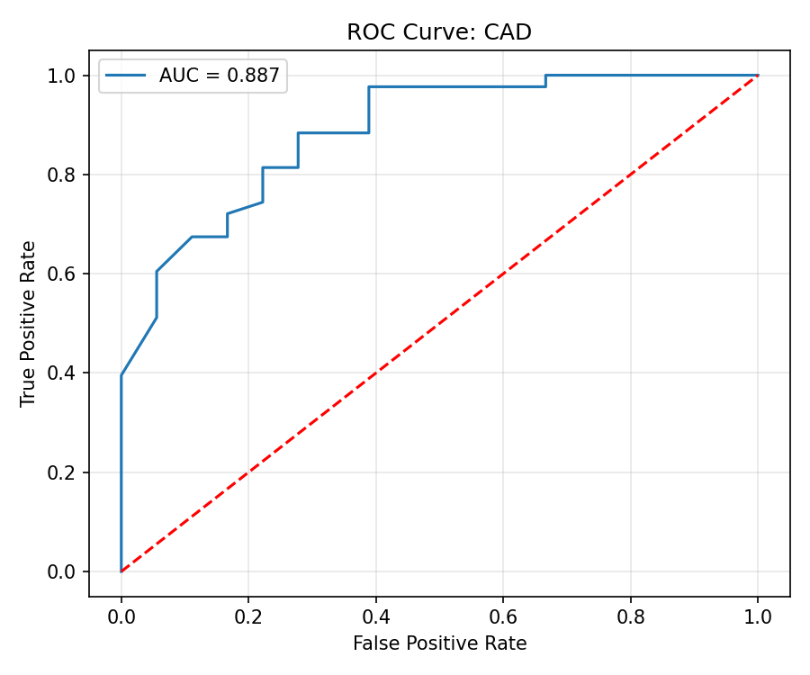 | 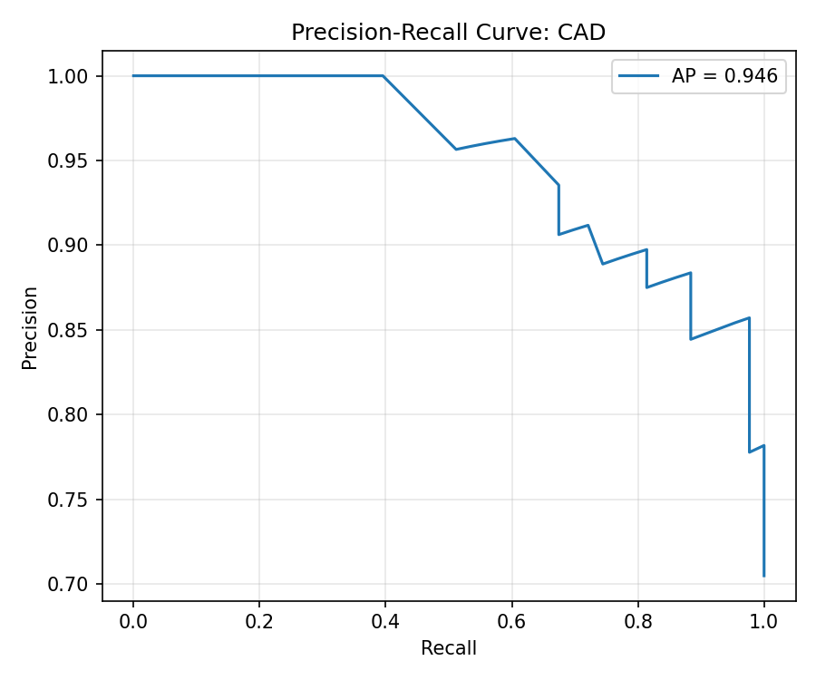 | 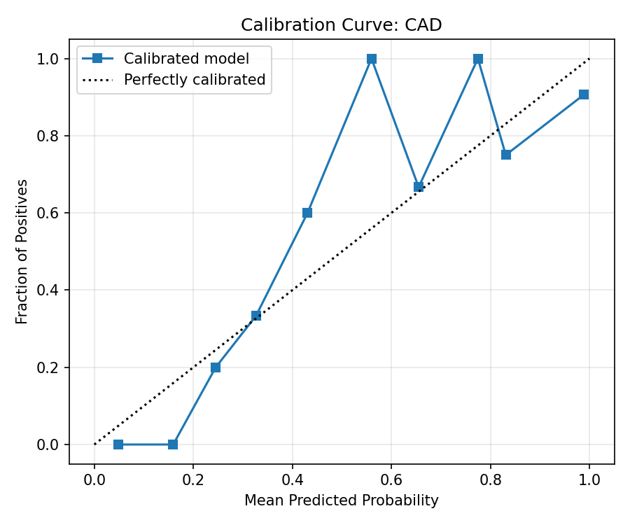 |

#### B. Territorial Vessel Diagnostics (LAD, LCX, RCA)
| Vessel Target | ROC Curve | Precision-Recall Curve | Confusion Matrix |
|:---|:---:|:---:|:---:|
| **LAD (Anterior)** | 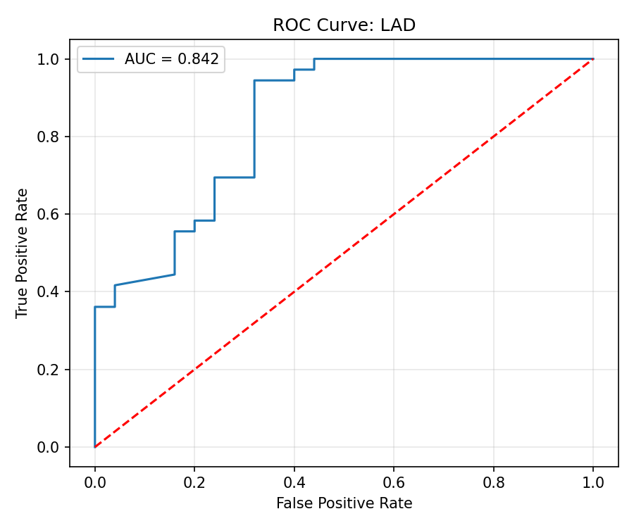 | 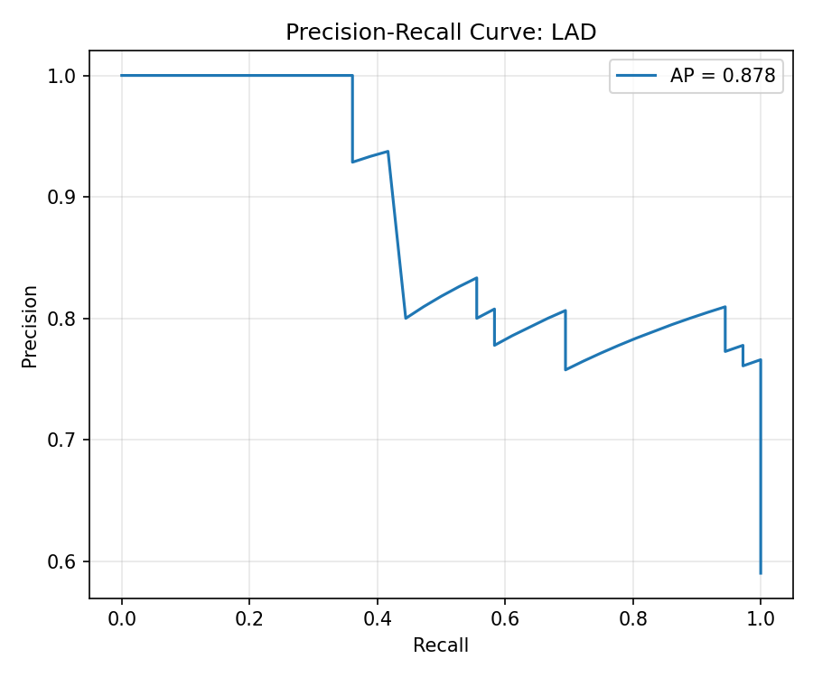 | 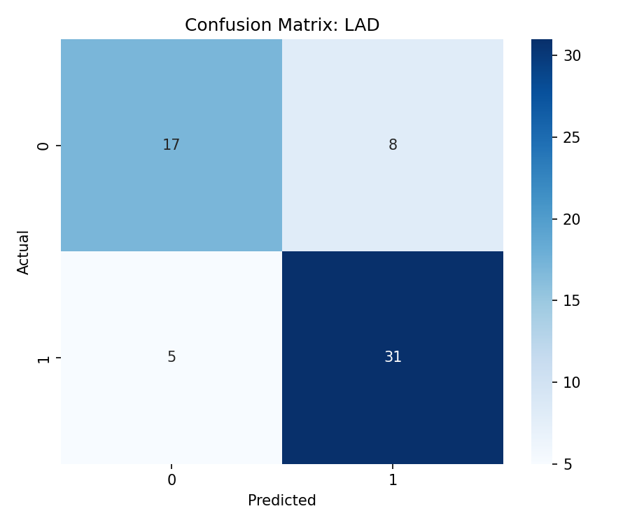 |
| **LCX (Circumflex)**| 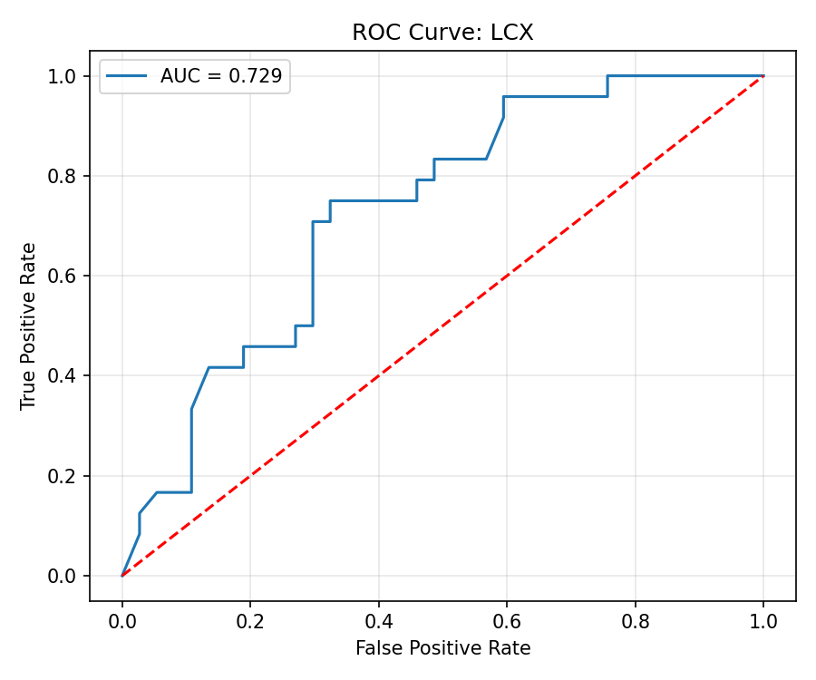 | 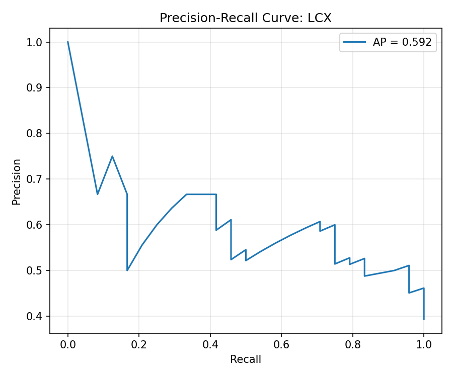 | 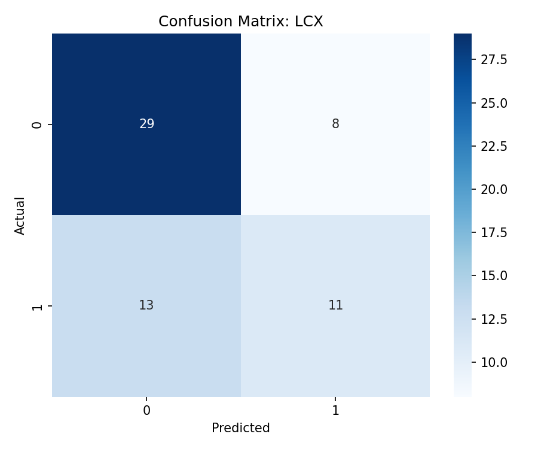 |
| **RCA (Right)** | 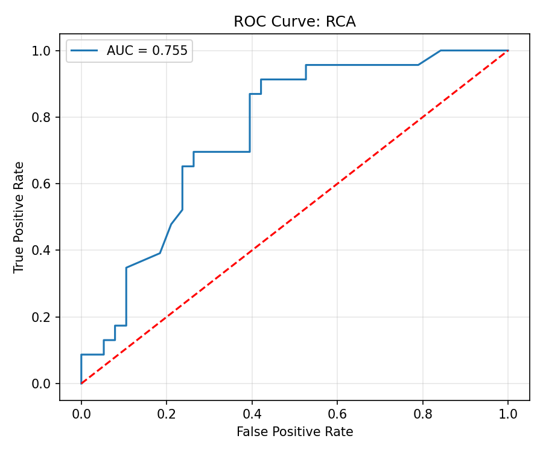 | 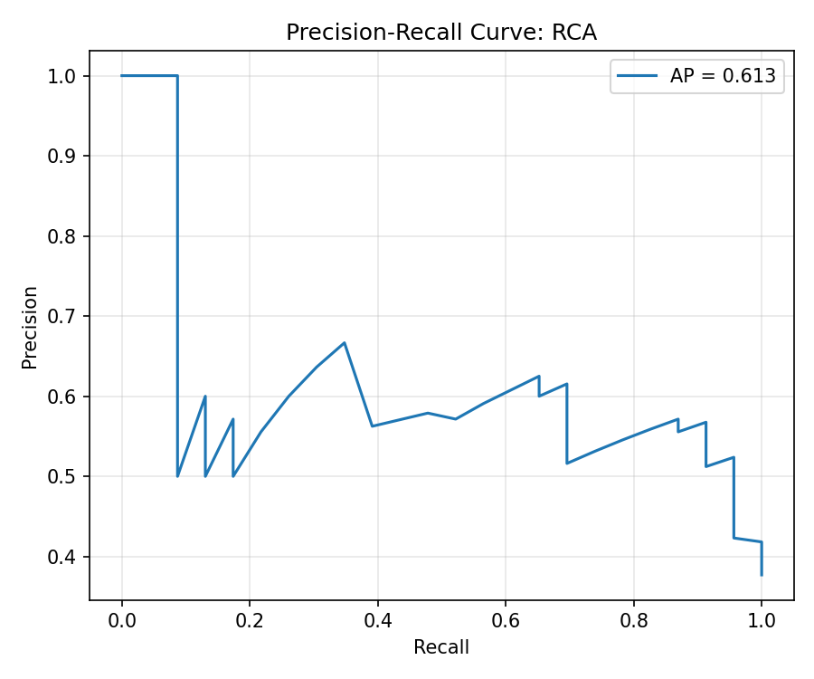 | 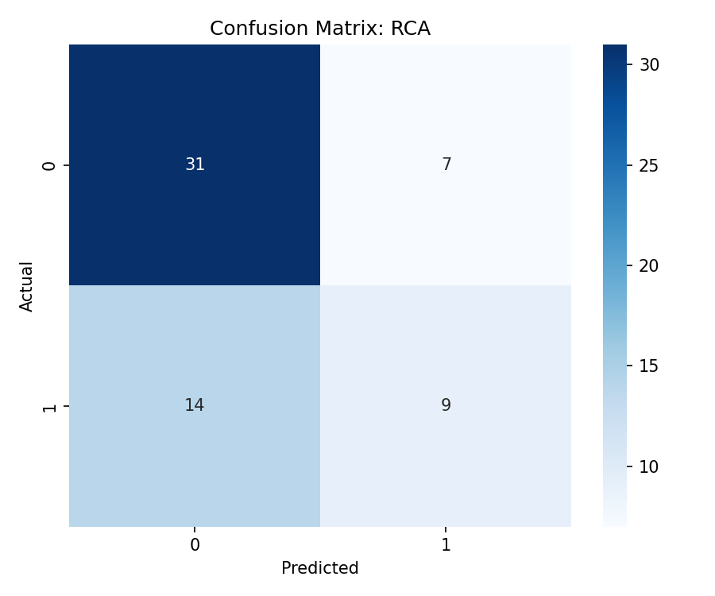 |

### 6.3 Analytical Interpretation
- **Overall CAD Detection:** Achieves exceptional discriminative capacity (ROC-AUC $0.9401$, Brier $0.0812$), establishing high reliability for initial non-invasive triaging.
- **LAD Territory:** The Stacking Ensemble attains an AUC of $0.8793$ and F1 of $0.8349$, providing dependable detection of high-acuity "widowmaker" anterior lesions.
- **LCX Challenges:** The LCX territory exhibited lower recall ($45.8\%$), reflecting known clinical and anatomical challenges: smaller ischemic territory, lower prevalence in the dataset ($34.3\%$), and less distinct surface ECG signatures.
- **Calibration Verification:** Isotonic calibration successfully flattened prediction error, with Brier scores across CAD and LAD falling below $0.12$. Calibration curves confirm observed event rates closely track predicted posterior probabilities.

---

## 7. Operational Instructions & Verification Runbook

### 7.1 Backend Setup (FastAPI + Python 3.10+)
```bash
# Navigate to backend directory
cd cardio-viz-3d/backend

# Create and activate virtual environment
python -m venv venv
# Windows:
.\venv\Scripts\activate
# Linux/macOS:
source venv/bin/activate

# Install dependencies
pip install -r requirements.txt

# (Optional) Re-train and calibrate all models
python models/train.py

# Launch FastAPI ASGI server
python -m uvicorn api.main:app --reload --port 8000
```
*API Swagger Documentation is available at: `http://127.0.0.1:8000/docs`*

### 7.2 Frontend Setup (React 18 + Vite)
```bash
# Navigate to frontend directory
cd cardio-viz-3d/frontend

# Install node dependencies
npm install

# Launch Vite development server
npm run dev
```
*Application workstation opens at: `http://localhost:5173`*

### 7.3 End-to-End Operational Workflow
1. **Clinical Disclaimer:** Accept the CDSS investigational use disclaimer modal upon initial entry.
2. **Archetype Selection:** Use the Clinical Persona Presets (e.g., *High-Risk Multi-Vessel*, *Isolated LAD Widowmaker*, *Borderline RCA*, *Young Low-Risk*) to auto-populate patient features.
3. **Execute Prediction:** Click **RUN ANALYSIS 🔬** to initiate inference across all 4 calibrated pipelines.
4. **Inspect 3D Cardiac Anatomy:** Rotate, zoom, and adjust myocardial opacity. Vessels transition dynamically from emerald green to amber or vibrant red.
5. **Isolate Specific Vessels:** Click LAD, LCX, or RCA to view the isolated arterial branch under optimal angiographic projections (AP, RAO, LAO) with full-screen support.
6. **Examine SHAP Explanations:** Review the ranked attribution waterfall to identify patient-specific risk drivers.
7. **Perform What-If Counterfactuals:** Adjust physiological sliders (e.g., lowering BP, increasing HDL, smoking cessation) to observe real-time probability reduction.
8. **Export Dossier:** Click **Export Dossier (PDF)** to produce a standardized clinical summary report.
